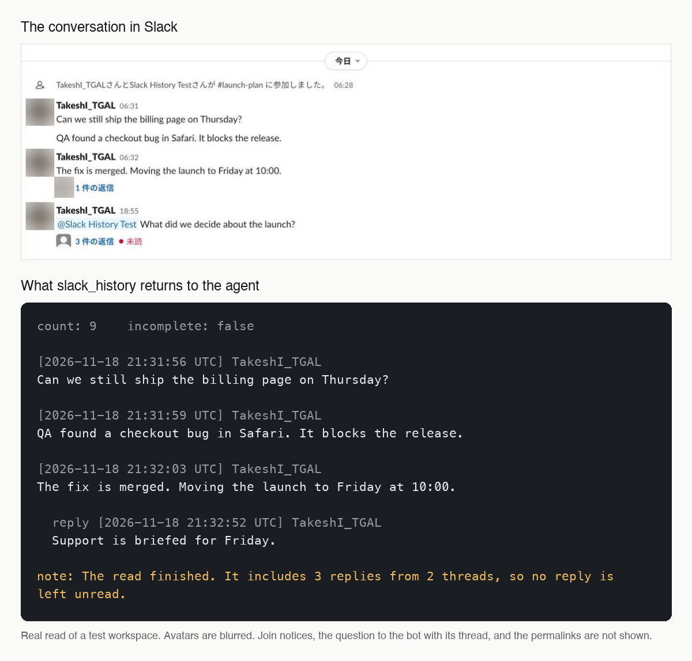

# Slack History

Say "Summarize this thread." in a Slack thread. The tool reads that thread and returns each speaker, time, link, and message so the reply can summarize them.

Say "What happened in this channel last week?" in a Slack channel. The tool reads the recent messages in that channel.

Say either sentence from the CLI or from a cron job. The tool reads nothing and tells you to ask again from the Slack channel.

## Install

Copy this directory to `$HERMES_HOME/plugins/slack-history`.

Add `slack-history` under `plugins.enabled` in `$HERMES_HOME/config.yaml`.

Store the existing Slack bot token as `SLACK_BOT_TOKEN` in the profile secret store. This plugin does not start a new OAuth flow and it does not ask for a user token.

Restart the gateway. In the Slack channel, say: Summarize this thread.

The tool name is `slack_history`. Its toolset name is `slack`. Hermes turns a plugin toolset on by default. The tool is off only when the saved config records `slack` under `known_plugin_toolsets` for the Slack platform and the saved Slack toolset list omits it. In that case the Slack platform note still says channel history cannot be searched, so add `slack` back to that list.

## What it reads

The default read is the current channel. When the conversation is already in a thread that has a reply from someone other than this bot, the read is that thread. Hermes gives a top-level Slack message a thread id when `reply_in_thread` is on, so a message with no replies reads the current channel. Passing the current channel id while the conversation is already in a thread still reads that thread. A channel id passed by the model is read only when it is the current channel or it appears in `extra_channels`.

`extra_channels` is a list of channel ids under the plugin settings. An empty list means the current conversation only.

Message text is returned inside an untrusted-data block. Speaker display names, timestamps, and permalinks are included. When `users.info` fails, the transcript shows the user id instead of a display name. The bot token is not included.

One call follows at most 4 pages of channel history. A top-level message spends one of those pages on the thread check, which leaves 3 for the channel. A channel read can add at most 5 pages of `conversations.replies`, one page for each of the newest parent messages that have replies. The call also requests `auth.test` once and `users.info` once for each speaker, so the number of HTTP requests can be higher than 4 even when there is no 429. A 429 whose `Retry-After` is 5 seconds or less is requested once more, which can raise that number again.

A channel read includes replies inside threads. It starts at the newest channel message and stops at 50 messages or 12000 characters of message text. Parent messages in that range that have replies are read with `conversations.replies`, newest parent first, at most 5 threads, and one page each. Reply text from those pages counts toward the same 50 messages and 12000 characters. A further page of a thread is not read. A reply that was already posted to the channel is kept once and is not repeated under the parent. `incomplete` is false only when every channel message in range was returned whole, every reply that fit those caps was returned whole, and none of the kept messages has unread thread replies. Otherwise `incomplete` is true. The note says what was left out: older messages, the end of a message or a reply cut at the character cap, replies that did not fit, or more than one of these. For a kept message whose `thread_ts` is absent or equal to its `ts`, a non-bool integer `reply_count` of 1 or more is that many unread replies, and the result gives that count and the message timestamp, which is the thread id. A non-bool integer `reply_count` of 0 is no unread replies when no reply from that thread is in the result, even when `thread_ts` is present. When `thread_ts` equals `ts`, both values are a valid Slack `ts`, and `reply_count` is missing, a string, a boolean, a decimal, a negative number, or another unusable shape, the message has replies and the count is unknown. When `thread_ts` is absent and `reply_count` is unusable, `latest_reply` or a `reply_users_count` of 1 or more means the same. A message whose valid `thread_ts` differs from `ts` is a reply in that thread: its own timestamp is not an unread item and its own `reply_count` is not added. When the parent with that `thread_ts` is already in the result and its count is a non-bool integer of 1 or more, the unread count is that count minus the number of replies with the same `thread_ts` whose text remains in the result. The same reply timestamp is counted once. A reply the message cap or the character cap left out of the result is not subtracted. When the remainder is 1 or more, the result names that parent once with the remainder, and the note uses that same number, singular or plural. When the remainder is 0 or less, that thread is not an unread item. A reply whose text was cut keeps the character-cap note. When that parent is in the result and its `reply_count` is a non-bool integer of 0, the thread is one item and the count is unknown, because a reply is visible. When that parent is not in the result, each `thread_ts` is one item and the count is unknown. Anything else is no unread replies. Known counts are totaled on their own. An unknown count is null, and the note does not state a combined total or say that the read finished. A broken value does not raise. A timestamp that is not a Slack `ts` is left out of the note and the result. A parent past the 5 thread cap stays in the note with that parent timestamp. Replies past the one page, the message cap, or the character cap stay in that note too.

A thread read follows the thread for up to 4 pages, then keeps the parent message and the newest replies inside the same message and character caps. The result says how many replies were omitted and which message was cut. When 4 pages do not reach the end of the thread, the result says the newest replies were not read. When Slack reports more replies than it returns, the result says their position is unknown.

These `auth.test` results stop the read before any channel or thread page: `ratelimited`, `invalid_auth`, `token_expired`, `token_revoked`, `account_inactive`, `not_authed`, `missing_token`, and `unscoped`. A short `Retry-After` on `ratelimited` is the one retry described above. The read stops when that retry is also `ratelimited` or the wait is longer than 5 seconds. A temporary failure such as `internal_error`, HTTP 500, or HTTP 503 still reads. When that failure does not identify this bot, a one-page thread of only bot replies reads the current channel and the result says those bot replies were not read. The same split applies when `auth.test` succeeds but does not identify this bot. A bot-only thread that continues past one page is read as a thread. A `limit` of 1 keeps only the newest reply.

## When it reads nothing

A CLI session, a cron turn, and any turn that is not Slack return an error and the next step. They do not call Slack.

Slack errors come back with a next step. `not_in_channel` means invite the bot. `missing_scope` means add `channels:history`, `groups:history`, `im:history`, and `mpim:history`, then reinstall the app. `ratelimited` waits for a short `Retry-After` and otherwise tells you how many seconds to wait. `invalid_auth`, `token_expired`, `token_revoked`, and `account_inactive` each say how to replace or restore the bot token.

The tool does not post, react, or edit.

## Remove

Remove `slack-history` from `plugins.enabled` and delete `$HERMES_HOME/plugins/slack-history`. The bot token stays in the profile secret store. Messages stay in Slack. This plugin does not write a transcript file.
